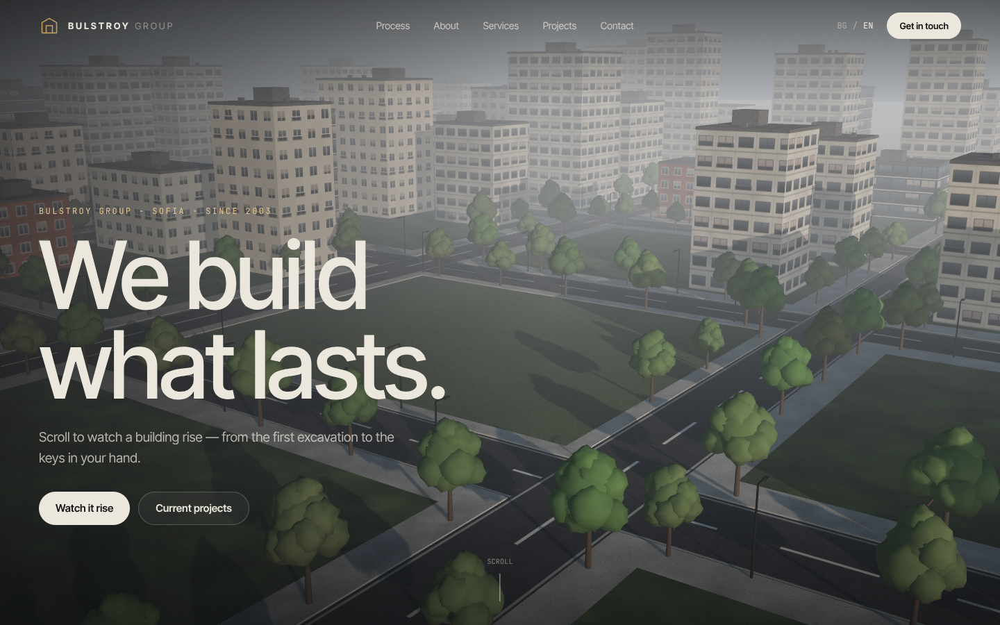
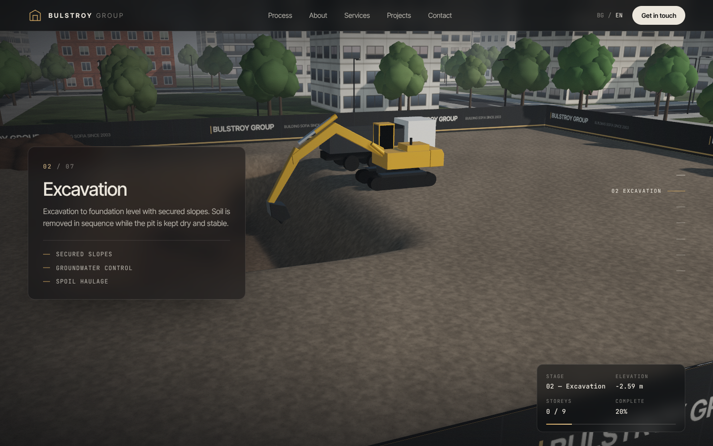
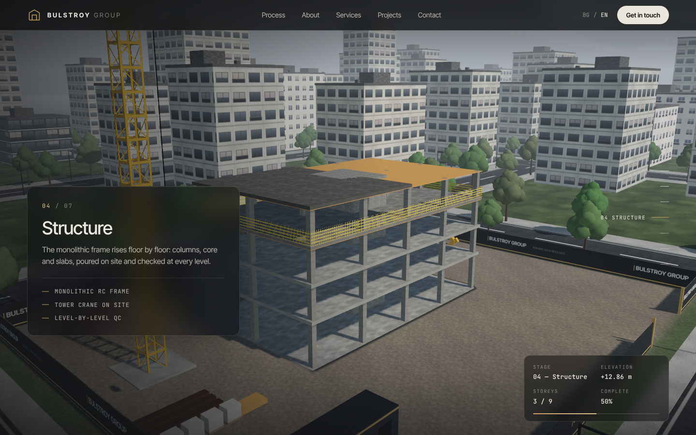
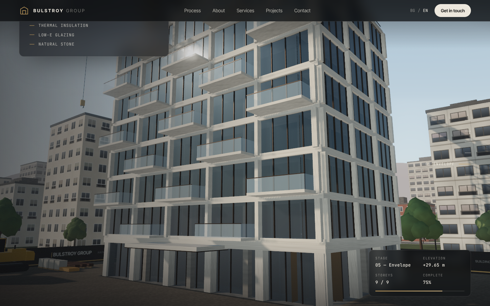
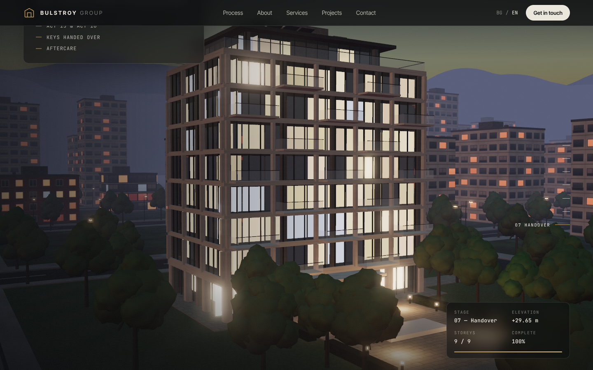
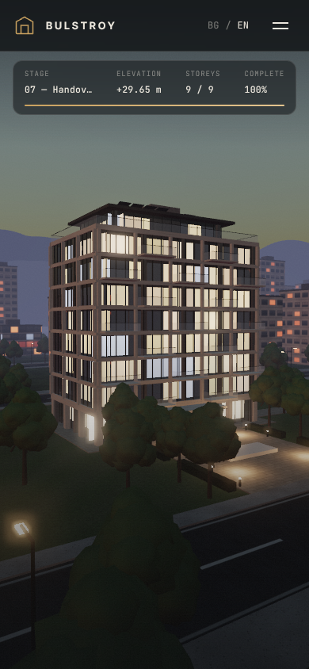

# Bulstroy Group: scroll-driven 3D website

A one-page site for Bulstroy Group, a residential builder in Sofia (founded 2003). As you scroll, a real-time 3D scene builds an apartment building from start to finish, in seven stages:

| Stage | What happens on screen |
| --- | --- |
| 01 Survey & permits | An empty plot at sunrise; survey stakes, string lines and a total station; site hoarding and site offices arrive |
| 02 Excavation | Topsoil is stripped; a tracked excavator digs the pit (bench method) and loads a dump truck; dust; spoil heap |
| 03 Foundation | Rebar mat, raft pour, basement walls, waterproofing, backfill; the tower crane goes up |
| 04 Structure | Columns, core and slabs rise floor by floor (fresh concrete darkens, then cures), with formwork and edge-protection netting; the crane climbs and lifts loads |
| 05 Envelope | Stone bands, fins, glazing and staggered balconies are installed floor by floor; the penthouse and rooftop plant go on |
| 06 Finishing | The crane climbs down and is removed; the hoarding comes down; paving, lawns, hedges, a water feature and trees grow in |
| 07 Handover | Blue hour: the interiors, street lamps and the surrounding city light up |

The lighting moves through the day as you scroll, from sunrise to blue hour. The page is bilingual: Bulgarian and English, auto-detected from the browser, with a toggle.

## Run locally

The page uses ES modules and an import map, so open it through a web server. Opening it as `file://` will not work.

```bash
npx http-server . -p 8080 -c-1   # or: python3 -m http.server 8080
# open http://localhost:8080
```

Add `?p=0.42` to the URL to jump straight to a point in the construction timeline (0–1).

## Deploy

The site is fully static: upload the repository as-is to any static host (Netlify, Vercel, GitHub Pages, S3, nginx). There is no build step. three.js r169 is vendored in `vendor/three/`, so the site does not depend on a CDN at runtime. Only the fonts load from Google Fonts.

## Structure

```
index.html            markup, all copy hooks (data-i18n)
css/style.css         design system + responsive layout
js/main.js            renderer, post-processing (bloom, ACES), render loop
js/ui.js              scroll→progress, stage cards, HUD, i18n, form
js/i18n.js            EN / BG copy
js/config.js          contact settings (CONFIRM BEFORE LAUNCH)
js/timeline.js        stage ranges + construction milestones
js/camera.js          cinematic camera path
js/world/*.js         environment, city, site, building, machines, trees
js/lib/*.js           maths helpers, procedural canvas textures
vendor/three/         three.js r169 (MIT)
```

## Before going live — verify with the company

The live site (bulstroygroup.com) could not be reached while this was built, so the content comes from public business directories. Please confirm:

- **`js/config.js` → `email`**: `office@bulstroygroup.com` is a placeholder. The enquiry form opens a pre-filled email to this address. Add `phone` to show the phone row.
- **About section**: founded 2003 by eng. Georgi Evtimov; 70+ team members (EMIS listed 72 for 2024); the "Building of the Year" award in 2014.
- **Projects**: Nadezhda, Darvenitsa 5 and Krastova Vada, all marked "In sales". Real photos or renders can replace the line drawings in `.project__art`.
- **Office address**: given as Izgrev, Sofia.
- The form has no backend; it uses `mailto:`. To store enquiries, point it at your CRM or a form service.

## Performance notes

- The 3D scene renders only while the construction section is on screen, and pauses in background tabs.
- Phones get a lower resolution, smaller shadow maps and fewer MSAA samples. On any device, the resolution drops automatically if frames are slow.
- Without WebGL2, the page falls back to a static, readable list of the stages.
- `prefers-reduced-motion` turns off camera drift, film grain and reveal animations.

## Preview

Frames from headless Chromium (software rendering; a real GPU will look smoother):

| | |
|---|---|
|  |  |
|  |  |
|  |  |
